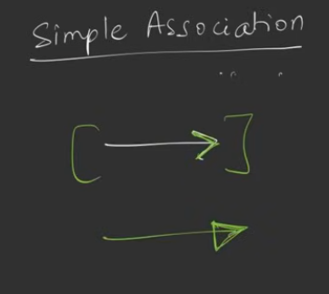
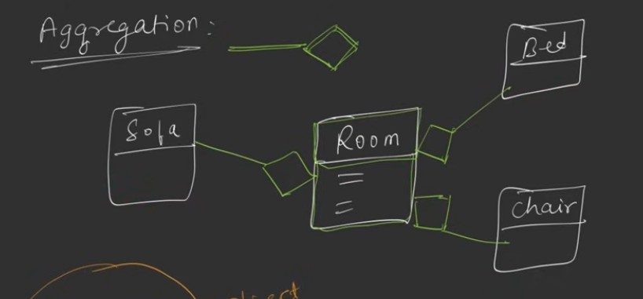
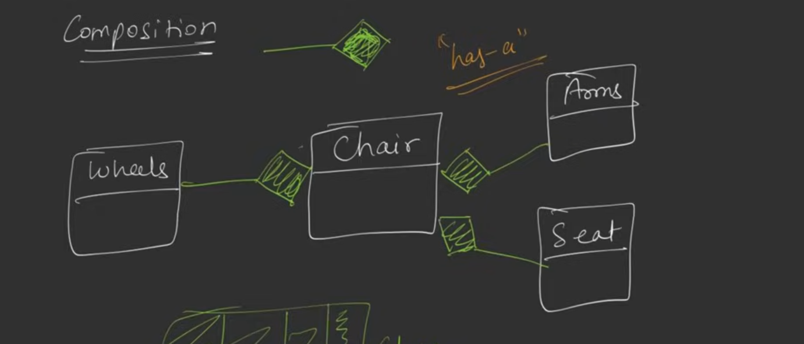

associations

1. simple association (has a relationship)
    Arjun lives in a house

    
    here look the first arrow is of this association 
    and the second one is of inheritance

2. Aggregation 
    acts as aggregator of objects
    room contains (sofa, bed, chair)
    

3. composition 
    very strong form of association 

    one cannot exist without other
    ex -> likes and comments can't exist without content
    

    